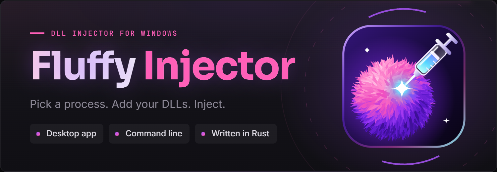
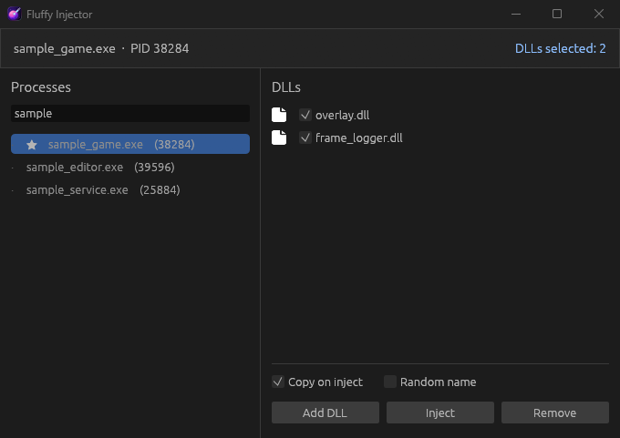

<p align="center">
  <a href="https://github.com/fluffysnaff/fluffy-injector/releases/latest">
    
  </a>
</p>

<p align="center">
  <b>Soft name. Sharp needle. One-click DLL injection for Windows.</b><br>
  Pick a running process, add your DLLs, and select Inject. Then run the same thing from your terminal.
</p>

<p align="center">
  <a href="https://github.com/fluffysnaff/fluffy-injector/releases/latest"><b>Download for Windows</b></a> |
  <a href="docs/cli.md">Command line</a> |
  <a href="docs/building.md">Build from source</a>
</p>

<p align="center">
  <a href="https://github.com/fluffysnaff/fluffy-injector/releases/latest"></a>
  <a href="https://github.com/fluffysnaff/fluffy-injector/actions/workflows/rust.yml"></a>
  <a href="LICENSE"></a>
</p>

<p align="center">
  
</p>

## Why you will like it

**Rebuild while your DLL is loaded.** Windows locks a loaded DLL, so your next build fails. Turn on **Copy on inject** and the target loads a temporary copy. Your original file stays free for the compiler.

**Restart your target without starting over.** The process list refreshes about twice per second. When your program closes and opens again, Fluffy Injector selects the new process by name. If several processes share that name, it asks you to choose.

**Drop in your DLLs.** Drag files from Explorer into the DLL list. Press `Ctrl+O` to add a DLL or `Ctrl+F` to filter processes.

**Set it up once.** Your DLL list, checked items, favorites, last target, and window layout are saved. Updating from 0.4 or earlier imports your old settings. Favorites stay at the top. Processes you block stay out of the list.

**Know what happened.** Fluffy Injector waits for Windows to finish loading each DLL, then reports success or the error. A DLL that is already loaded is left alone.

**Click or script.** One executable under 2 MB is both the desktop app and the command-line tool. No console window opens with the app, and opening it twice shows the window you already have.

## Where it fits

- **You develop a plugin or overlay.** Run one command after each build and test the new DLL right away.
- **You study how a program behaves.** Load your own logging DLL into a process you are allowed to inspect.
- **You make mods.** Load several DLLs at once into an application that permits it.

## Get started

1. Download the [latest release](https://github.com/fluffysnaff/fluffy-injector/releases/latest).
   - `FluffyInjector-<version>-setup.exe` installs the app and adds the command to your PATH.
   - `fluffy_injector.exe` runs without installing.
2. Select a process on the left.
3. Drag your DLLs into the list, or select **Add DLL**. Check the files you want.
4. Select **Inject**.

Right-click a process to favorite or block it. To unblock one, right-click empty space in the process list and open **Blocked**. Right-click a DLL to inject it alone, open its folder, or remove it.

The setup program requires 64-bit Windows 10 or later. Fluffy Injector loads 64-bit DLLs into 64-bit processes. If the target runs as administrator, run Fluffy Injector as administrator too.

## Use it from your build script

```powershell
# Inject one DLL by process name
fluffy_injector notepad.exe C:\hooks.dll | Out-Host

# Keep the original file free for the next build
fluffy_injector --copy notepad.exe C:\hooks.dll | Out-Host

# Inject several DLLs by process ID
fluffy_injector 1234 C:\hooks.dll C:\overlay.dll | Out-Host
```

`| Out-Host` makes PowerShell wait for the result. Exit code `0` means every DLL is loaded. See the [command-line guide](docs/cli.md) for all options and exit codes.

## Contribute

Found a bug or have an idea? [Open an issue](https://github.com/fluffysnaff/fluffy-injector/issues). Please open one before sending a pull request, so we can agree on the change first.

Built with [taut](https://crates.io/crates/taut), [wraith-rs](https://crates.io/crates/wraith-rs), and [windows-rs](https://github.com/microsoft/windows-rs). Released under the [MIT License](LICENSE).

<a href="https://www.star-history.com/#fluffysnaff/fluffy-injector&Date">
  
</a>
